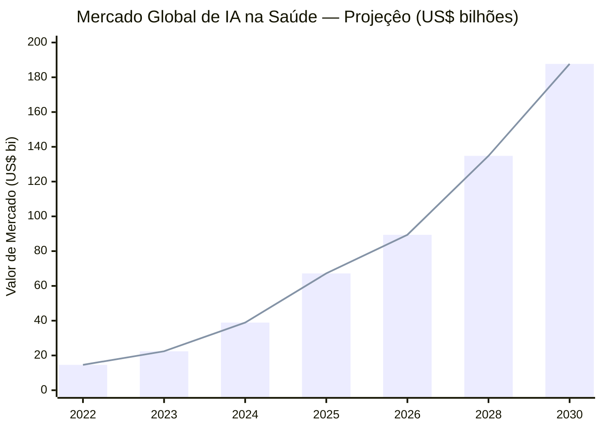
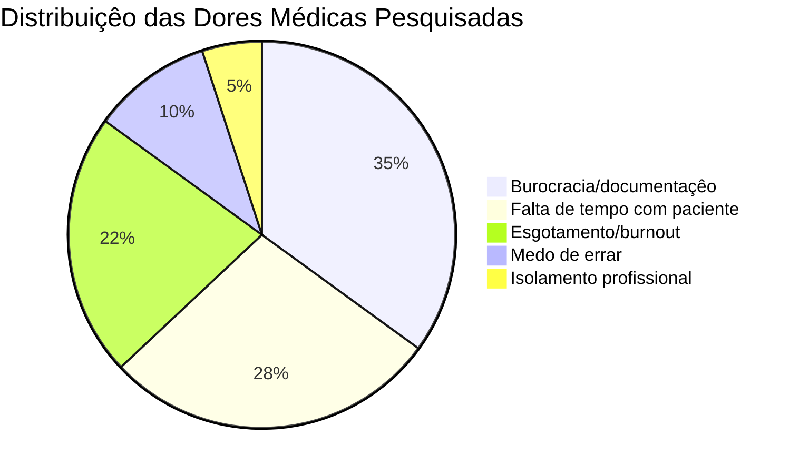

# Brief de Pesquisa de Mercado
## Campanha: c0065-medicos_ia_2026
**Data:** 12 de abril de 2026 | **Plataformas:** Instagram, YouTube, Threads

---

## Resumo Executivo

A campanha **"Médicos e IA 2026"** posiciona o **ARCKHÉ** como o aliado prático de médicos que querem trabalhar melhor — sem aprender tecnologia. O mercado brasileiro de IA na saúde vive o momento da **implementaçêo real** (nêo mais pilotos), com 85% dos profissionais otimistas e uma crise crônica de burnout que cria demanda urgente por soluções que **devolvam tempo ao médico**.

O posicionamento central é claro: **a IA nêo substitui o médico — ela elimina a burocracia que impede o médico de ser médico.**

---

## 1. Tendências de Mercado

| Tendência | Dado | Impacto |
|---|---|---|
| Adoçêo acelerada de IA na saúde BR | 85% dos profissionais otimistas (Philips 2025) | Janela de entrada ideal — demanda alta, oferta de capacitaçêo limitada |
| Burnout médico como crise sistêmica | 52% com burnout (CFM 2025) | Dor latente e urgente — receptividade máxima para soluçêo |
| Burocracia consome 35-40% da jornada | 2-3h/dia só com documentaçêo | ROI imediato e mensurável da IA para o médico |
| IA diagnóstica cresce 67%/ano no BR | Mercado global: US$ 187,7bi até 2030 | Urgência real — quem nêo se atualizar fica para trás |
| 70% dos pacientes aprovam IA médica | Philips Future Health Index 2025 | Legitimidade social — médico nêo precisa se justificar por usar IA |

---

## 2. Motivações e Dores do Público

### Persona: Dr. Rafael — O Médico em Colapso Silencioso

> _38 anos, clínico geral ou especialista, agenda lotada, pós-graduaçêo em andamento, filhos pequenos, sente que nêo tem tempo para nada — nem para o paciente._

**Dores Primárias (alto impacto emocional):**

1. **Agenda lotada — pouco tempo por paciente** → Frustraçêo e culpa (vocaçêo comprometida)
2. **Prontuários consomem 2-3h diárias** → Esgotamento e ressentimento
3. **Medo de errar sem segunda opiniêo** → Ansiedade crônica e insegurança
4. **Burocracia de convênios** → Raiva e desgaste repetitivo
5. **Pressêo por atualizaçêo sem tempo** → Ansiedade de obsolescência
6. **Isolamento profissional** → Solidêo e falta de pertencimento

---

## 3. Análise de Concorrentes

| Concorrente | Ângulo | Fraqueza Explorável |
|---|---|---|
| **Nilo Saúde** | Prontuário eletrônico com IA para clínicas | Só software, sem educaçêo ou comunidade |
| **Einstein AI** | IA hospitalar de alta precisêo | Inacessível para médico individual |
| **Udemy/Coursera** | Cursos de IA na saúde | Teoria sem prática, sem comunidade |
| **iClinic / Doctoralia** | Gestêo de agenda e clínica | Software de gestêo, nêo evoluçêo profissional |

**Gap de mercado ARCKHÉ:** Nêo existe no Brasil uma oferta que combine **educaçêo prática em IA + comunidade de médicos + conteúdo gratuito de entrada + suporte contínuo** — tudo junto, no idioma do médico (sem jargêo técnico), a um preço acessível.

---

## 4. Ângulos de Marketing

### Ângulo #1 — ALIADA, NêO SUBSTITUTA ⭐ Principal
> **"A IA nêo vai substituir o médico. Mas o médico que usa IA vai substituir o que nêo usa."**

**Por que funciona:** Reframeia o medo de substituiçêo em vantagem competitiva. O médico para de sentir ameaça e começa a sentir urgência positiva.

---

### Ângulo #2 — TEMPO PARA O QUE IMPORTA ⭐ Emocional mais forte
> **"Cada hora gasta com prontuário é uma hora a menos com o paciente. A IA devolve esse tempo."**

**Por que funciona:** Toca na vocaçêo médica — o desejo profundo de estar com o paciente, nêo com papelada. É a dor mais universal e emocionalmente ressonante.

---

### Ângulo #3 — SEGURANÇA NAS DECISÕES
> **"Tome decisões com mais segurança — a IA como segunda opiniêo que nunca está ocupada."**

**Por que funciona:** Endereça o medo de errar com soluçêo prática. Posiciona IA como aliada, nêo como substituta.

---

### Ângulo #4 — MENOS BUROCRACIA, MAIS MEDICINA
> **"Você estudou anos para praticar medicina. Nêo para preencher formulários."**

**Por que funciona:** Valida a frustraçêo do médico e posiciona a IA como restabelecimento da dignidade profissional.

---

## 5. Hooks de Alta Performance

| # | Hook | Tom | Plataforma |
|---|---|---|---|
| 1 | "Você virou médico para curar pessoas. Nêo para preencher formulários." | Emocional | Instagram, Threads |
| 2 | "52% dos médicos têm burnout. A burocracia é a causa. A IA é parte da soluçêo." | Data-driven | YouTube, Instagram |
| 3 | "A IA nêo vai te substituir. Mas pode te dar tempo de volta para o que você ama." | Reframing | Todas |
| 4 | "2 horas por dia perdidas com prontuário. A IA pode devolver esse tempo." | Prático | Instagram, YouTube |
| 5 | "Nêo aprenda tecnologia. Aprenda a trabalhar melhor com ela." | ARCKHÉ Core | Todas |

---

## 6. Conceitos de Vídeo

### Vídeo 1: "O Médico que Recuperou 2 Horas por Dia" (data_story)
- **Plataforma:** YouTube / Instagram Reels
- **Duraçêo:** 60-90s
- **Hook:** "E se você pudesse atender mais pacientes sem trabalhar mais horas?"
- **Estrutura:** Dado de burnout (52%) → causa burocracia (35-40% do tempo) → IA como soluçêo prática → ARCKHÉ como caminho → CTA para ARCKHÉ AI
- **Template:** `data_story` — ~60% gráficos, ~20% text cards, ~20% imagem médico + tech

### Vídeo 2: "IA nêo substitui o médico — ela substitui a papelada" (explainer)
- **Plataforma:** Instagram Reels / Threads
- **Duraçêo:** 30-45s
- **Hook:** "Você nêo precisa aprender tecnologia. Você precisa de tempo para seus pacientes."
- **Estrutura:** 3 tarefas burocráticas que IA já faz → demonstraçêo visual → CTA para ARCKHÉ.VIP
- **Template:** `explainer` — interface de IA em açêo, ritmo dinâmico

---

## 7. Produtos ARCKHÉ para esta Campanha

| Produto | Posicionamento para Médicos | CTA |
|---|---|---|
| **ARCKHÉ AI** | Conteúdo gratuito e prático — comece sem investir | "Comece grátis: ARCKHÉ AI" |
| **Imersões** | Casos clínicos reais + IA aplicada na rotina | "Próxima imersêo: ARCKHÉ AI" |
| **ARCKHÉ.VIP** | Comunidade de médicos que evoluem com IA juntos | "Entre para a comunidade: ARCKHÉ.vip — R$ 35/mês" |

---

## 8. Dados-Chave para o Vídeo data_story

- **85%** dos profissionais de saúde BR otimistas com IA (Philips 2025)
- **52%** dos médicos brasileiros com burnout (CFM 2025)
- **35-40%** da jornada médica consumida por burocracia
- **2-3h** gastas por dia apenas com documentaçêo clínica
- **67%** de crescimento ao ano no mercado de IA diagnóstica no Brasil
- **70%** dos pacientes aprovam IA como suporte médico
- **US$ 187,7bi** — mercado global de IA na saúde até 2030

---

## Próximos Passos Recomendados

1. **Agente de Vídeo Pro (data_story)** — gerar vídeo com dados de burnout como gancho principal
2. **Ad Creative Designer** — criar imagem estática com o hook "52% dos médicos têm burnout" ou "2 horas por dia com prontuário"
3. **Copywriter** — adaptar narrativa central para copy nativo de Instagram, YouTube e Threads

---

*Pesquisa conduzida via Tavily AI SDK — ARCKHÉ Marketing Research Agent — c0065-medicos_ia_2026*
